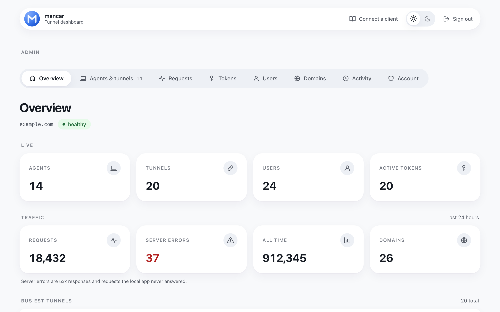
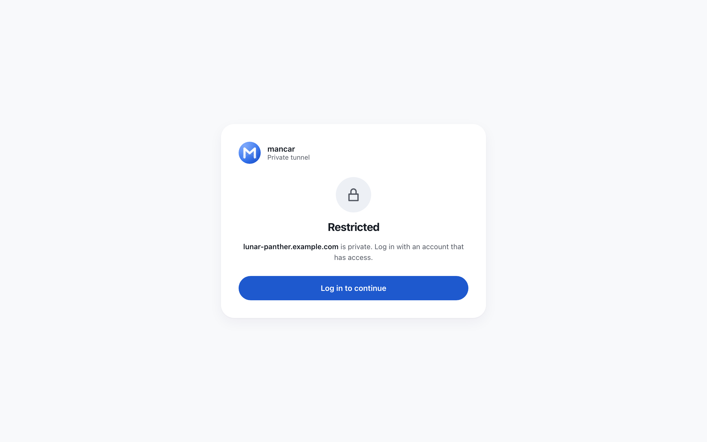
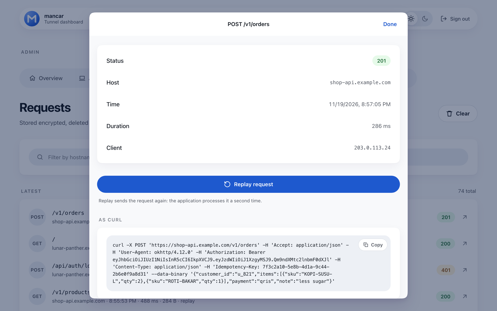
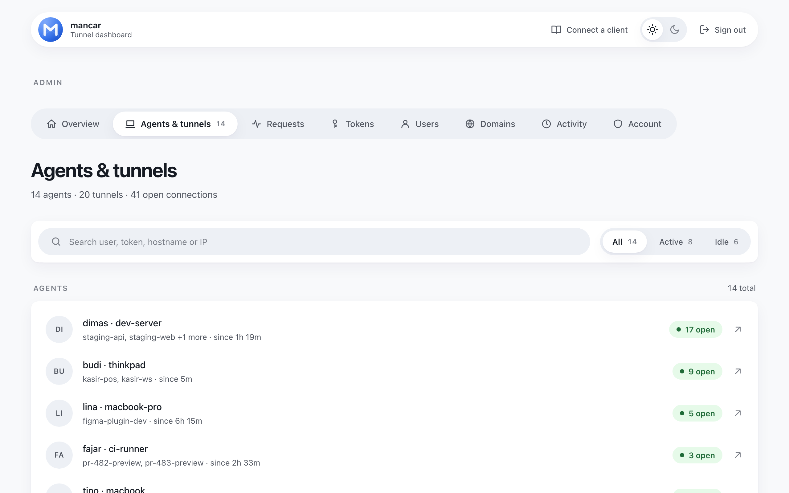
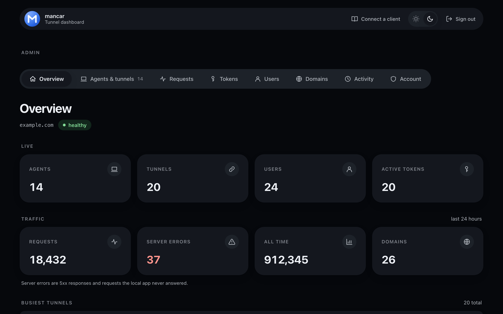
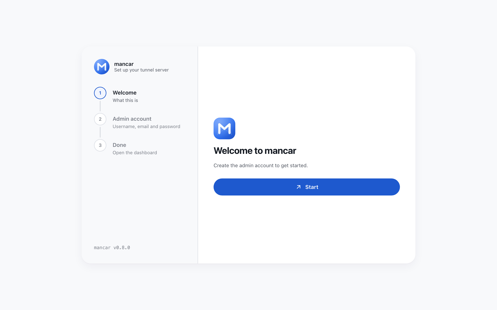

# mancar

**Share what runs on your laptop, from your own server, on your own domain.**
Like ngrok, but self-hosted: one command gives `localhost` a public HTTPS
address, and every byte goes through a server you control.

```text
$ mancar http 3000 --subdomain my-api

Forwarding:
https://my-api.example.com  ->  http://localhost:3000
```



## Why mancar

- **Your domain, your data.** Traffic, logs and accounts live on your server.
  No third party sees your requests, and the only limits are the ones you set.
- **Share safely, not just publicly.** Open a tunnel to everyone, only to
  yourself, to named teammates, or to anyone with a password.
- **See every request.** A live log in your terminal, plus a dashboard to
  inspect headers and bodies and replay a request with one click.
- **Built for a team.** Accounts, roles, per-person tokens, a web dashboard,
  `mancar login` through the browser, traffic stats per tunnel.
- **Stays out of your way.** Automatic HTTPS, automatic reconnect with the
  same address, self-update, a one-line install for macOS, Linux and Windows.
- **Small.** The whole server runs comfortably on a 1 GB VPS with Docker.

## Share it the way you want

| Command | Who can open it |
| --- | --- |
| `mancar http 3000` | Anyone with the link |
| `mancar http 3000 --private` | Only you, after signing in to the dashboard |
| `mancar http 3000 --allow budi,ana` | You, plus the accounts you name |
| `mancar http 3000 --auth client:s3cret-pass` | Anyone with the user name and password, no account needed |

A private tunnel shows visitors a **Restricted** page with a **Log in to
continue** button; once signed in, people who have access go straight to the
app. A password tunnel uses the browser's own login prompt
(`curl -u client:s3cret-pass` from scripts). Either way, refused visitors never
reach your app.



## See what's happening

Requests appear in your terminal as they arrive. Static files are folded into
one line, so the requests that matter stand out:

```text
14:02:11  GET    /                                        200 OK                   45 ms
          + 23 static files (1.2 MB)
14:02:13  POST   /api/login                               401 Unauthorized         8 ms
14:02:14  GET    /assets/app.js                           404 Not Found            2 ms
```

The dashboard's **Requests** page keeps the full request and response
(encrypted, deleted automatically), lets you **replay** it against your
tunnel, or copy it as `curl`. Handy for debugging webhooks.



| Every client and tunnel, live | Light or dark |
| --- | --- |
|  |  |

---

## Get started



mancar has two parts:

| | Runs on | Does |
| --- | --- | --- |
| `mancard` | your server (Docker) | receives public traffic, hosts the dashboard |
| `mancar` | your laptop | connects to the server, forwards to `localhost` |

Already have a server? Skip to [Use the client](#use-the-client).

### Set up the server

**You need:** a VPS with a public IP and Docker; a domain on **Cloudflare** DNS
with an [API token](https://dash.cloudflare.com/profile/api-tokens) limited to
that zone (*Zone / DNS / Edit* and *Zone / Zone / Read*;
[step by step](docs/DEPLOYMENT.md#3-cloudflare-api-token)); ports **80**,
**443** and **20000-20099** (TCP tunnels) open.

**1. Point the domain at the server.** In Cloudflare, two `A` records, **DNS
only** (grey cloud):

| Type | Name | Value |
| --- | --- | --- |
| A | `@` | server IP |
| A | `*` | server IP |

(For `tunnel.example.com` instead of the bare domain, use `tunnel` and
`*.tunnel`.)

**2. Configure.**

```bash
git clone https://github.com/tinoimammp/mancar.git && cd mancar
./scripts/setup.sh     # creates .env and generates the secrets
nano .env              # set BASE_DOMAIN, ACME_EMAIL, CLOUDFLARE_API_TOKEN
```

**3. Start.**

```bash
docker compose pull && docker compose up -d --wait
```

Already running nginx on 80/443? Use [docs/NGINX.md](docs/NGINX.md) instead;
your other sites keep working.

**4. Create the first admin.** Open `https://YOUR_DOMAIN/dashboard/` straight
away: a fresh server greets you with a short setup wizard (welcome, admin
account, done) and signs you in. Do it right after starting, because until an
admin exists whoever opens the page first gets the wizard. Prefer the command
line? On the server:

```bash
docker compose exec gateway /mancard user create admin --admin
```



**5. Invite people.** Let them run `mancar login` (below), or create a token
under **Tokens → New token**. To let people sign up on their own, set
`REGISTER_ENABLED=true` and `SMTP_URL`
([details](docs/OPERATIONS.md#sign-up-from-the-web)).

**Updating** is one line (take a backup first with `scripts/backup.sh`):

```bash
docker compose pull && docker compose up -d --wait   # tunnels pause briefly, then reconnect
```

`MANCAR_VERSION` in `.env` is `latest` by default; pin a release with e.g.
`MANCAR_VERSION=0.8.0` (no `v`).

### Use the client

**1. Install** (always the latest release, checksum verified):

```bash
# macOS / Linux
curl -fsSL https://raw.githubusercontent.com/tinoimammp/mancar/main/scripts/install.sh | sh
```

```powershell
# Windows (PowerShell, no administrator needed)
irm https://raw.githubusercontent.com/tinoimammp/mancar/main/scripts/install.ps1 | iex
```

On macOS and Linux it installs to `/usr/local/bin` and asks for sudo if needed;
pipe it to `MANCAR_INSTALL_DIR=$HOME/.local/bin sh` to avoid sudo. Later,
`mancar update` (or `sudo mancar update`) brings it up to date.

**2. Log in.**

```bash
mancar login https://YOUR_DOMAIN
```

Your browser opens: sign in, check that the code matches your terminal, click
**Allow**. Done. (On a machine without a browser:
`mancar config set server https://YOUR_DOMAIN`, then
`mancar config set token -` and paste a token.)

**3. Share something.**

```bash
mancar http 3000 --subdomain my-api   # https://my-api.YOUR_DOMAIN
```

## Everyday commands

```bash
mancar http 3000                      # asks: random name, your own, or a recent one
mancar http 3000 --random             # e.g. https://blue-falcon.YOUR_DOMAIN
mancar http 3000 --last               # the name you used last time
mancar tcp 5432                       # raw TCP (database, SSH): YOUR_DOMAIN:200xx

mancar http 3000 --private            # only you
mancar http 3000 --allow budi,ana     # you and these accounts (usernames or emails)
mancar http 3000 --auth client        # password from MANCAR_AUTH_PASSWORD

mancar http 3000 --log errors         # only 4xx/5xx (--log all, --quiet)
```

Save tunnels once and start them together:

```bash
mancar config add-tunnel web   http 3000 --subdomain my-api
mancar config add-tunnel db    tcp  5432
mancar config add-tunnel admin http 8080 --private
mancar start        # start them all
mancar status       # what's running
mancar stop         # stop everything
```

`mancar help` lists everything.

### Good to know

- **Your address is kept.** If the connection drops, the client reconnects on
  its own and keeps the same address. A custom name stays yours for 24 hours
  after you disconnect, a random one for 5 minutes
  (`HOSTNAME_HOLD_CUSTOM` / `HOSTNAME_HOLD_RANDOM` on the server).
- **Private tunnels** work for HTTP on servers with the dashboard. Access lasts
  12 hours per browser. Requests without a browser (curl, webhooks) get `401`,
  so use a public or password tunnel for those.
- **Password tunnels:** at least 8 characters. The server checks it and never
  passes it to your app; 20 wrong tries from one address within 10 minutes are
  blocked until that window ends. Give only `--auth USER` and set
  `MANCAR_AUTH_PASSWORD` to keep the password out of your shell history. A
  saved `--auth` keeps its password in your config file (readable only by
  you). A tunnel is private *or* behind a password, not both; apps that use
  the `Authorization` header themselves should use `--private`.
- **Environment:** `MANCAR_SERVER` and `MANCAR_TOKEN` override the config file;
  `MANCAR_NO_UPDATE_CHECK=1` turns off update checks.

## All features

| Area | Feature | |
| --- | --- | --- |
| Tunnels | HTTP / HTTPS, WebSocket, streaming (SSE, long polling) | ✅ |
| | Raw TCP (databases, SSH, game servers) | ✅ |
| | Custom (`my-api`) or random (`blue-falcon`) subdomains | ✅ |
| | Several tunnels per client, saved and started together | ✅ |
| | Live request log, static files summarised | ✅ |
| | Automatic reconnect with the same address | ✅ |
| | Self-update with checksum verification | ✅ |
| | UDP tunnels; your own domains (not just subdomains) | ❌ |
| Access | Private tunnels (`--private`), shared with accounts (`--allow`) | ✅ |
| | Password in front of a tunnel (`--auth`) | ✅ |
| | IP rules in front of a tunnel | ❌ |
| Server | Automatic wildcard HTTPS (Let's Encrypt via Cloudflare DNS) | ✅ |
| | Standalone (bundled Caddy) or behind an existing nginx | ✅ |
| | Docker Compose, PostgreSQL with PgBouncer, automatic migrations | ✅ |
| | Backup / restore scripts, health checks, JSON logs | ✅ |
| Dashboard | Live clients and tunnels, disconnect a client | ✅ |
| | Tokens: create, revoke (disconnects at once), `mancar login` | ✅ |
| | Accounts with admin and user roles; sign up with email confirmation | ✅ |
| | Disable, promote, limit and reset accounts; activity log | ✅ |
| | Traffic per hostname and user: 24 h, 7 days, all time | ✅ |
| | Request inspector and replay (encrypted, auto-deleted) | ✅ |
| Security | Tokens and passwords stored only as hashes | ✅ |
| | Users cannot take over each other's hostnames | ✅ |
| | Limits on tunnels, connections, request size; login rate limits | ✅ |
| | Signed cookies, CSRF protection, strict CSP | ✅ |

Details: [docs/STATUS.md](docs/STATUS.md).

## How it works

```text
 visitor ──HTTPS──▶ edge (TLS) ──▶ mancard (gateway) ◀── one connection ── mancar (laptop) ──▶ localhost:3000
                                        │
                                    PostgreSQL
```

The client makes one outbound connection to your server, so nothing on your
laptop listens to the internet and no router setup is needed. The server maps
`name.YOUR_DOMAIN` to the client that owns it and streams each request through
that connection. HTTPS is handled by the bundled Caddy (one wildcard
certificate) or by your own nginx.

## Documentation

| | |
| --- | --- |
| [docs/DEPLOYMENT.md](docs/DEPLOYMENT.md) | Server setup in detail, troubleshooting |
| [docs/NGINX.md](docs/NGINX.md) | Running behind an existing nginx |
| [docs/OPERATIONS.md](docs/OPERATIONS.md) | Accounts, tokens, backups, upgrades, logs |
| [docs/SECURITY.md](docs/SECURITY.md) | What is and is not protected |
| [docs/STATUS.md](docs/STATUS.md) | Feature-by-feature status |
| [docs/protocol.md](docs/protocol.md), [docs/adr](docs/adr) | Protocol and design decisions |

## Development

```bash
make check     # gofmt, vet, tests with the race detector, shellcheck
make build     # bin/mancard and bin/mancar
make dist      # release binaries for all platforms
```

PostgreSQL tests run when `TEST_DATABASE_URL` is set (see the `Makefile`).
Releases are built by pushing a `v*` tag.

## License

MIT, see [LICENSE](LICENSE).
